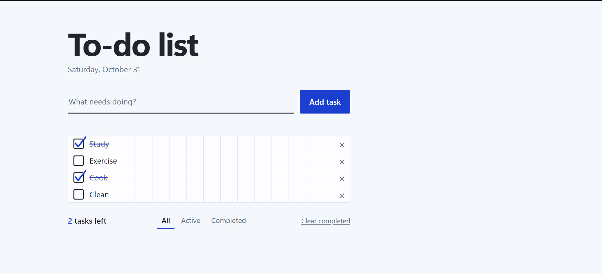
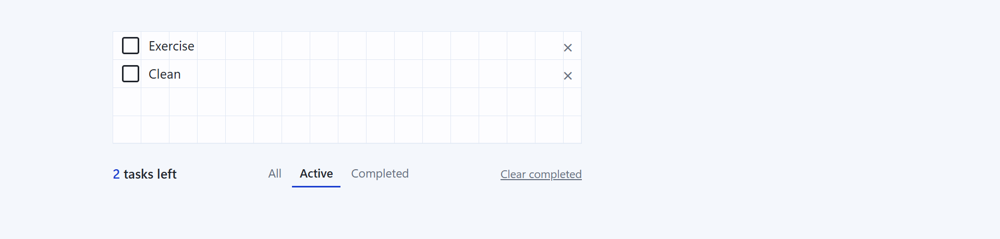
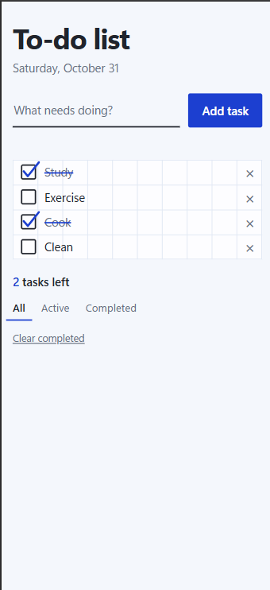
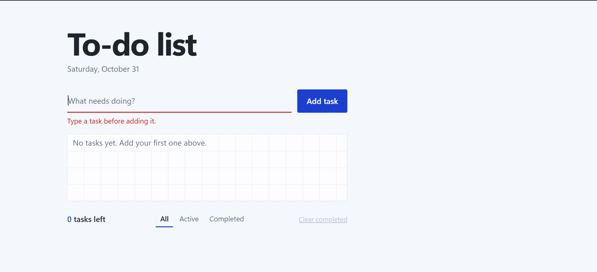

# To-Do List

A simple to-do list built with plain HTML, CSS and vanilla JavaScript. Tasks are saved in your browser, so they are still there after a refresh. No frameworks and no build step.

**Live demo:** https://laprimus.github.io/Todo-App/



## Features

- **Add tasks** with the button or the Enter key.
- **Empty tasks are rejected** with a message under the input. The message clears as soon as you start typing.
- **Complete tasks:** ticking a task draws a pen-style tick and strikes through the text.
- **Delete tasks** with the × button, or remove all finished ones at once with **Clear completed**.
- **Counter** showing how many tasks are left.
- **Filters:** All, Active and Completed, with a friendly message when a view is empty.
- **Saved in `localStorage`:** your tasks and which ones are completed survive a page refresh. If the saved data is damaged, the app starts with an empty list instead of breaking.
- **Responsive layout** that works on phones. Long words wrap instead of overflowing.
- **Graph-paper design:** every task row is exactly one grid square tall, so the text sits between the lines.

## Screenshots

| Tasks and filters | On a phone |
| --- | --- |
|  |  |



## How it works

- The tasks live in an array of objects (`id`, `text`, `completed`).
- `saveTasks()` writes the array to `localStorage` after every change, and `loadTasks()` reads it back when the page opens.
- `render()` rebuilds the list for the current filter and updates the counter.
- One event listener on the list handles every checkbox and delete button (event delegation).
- Task text is added with `textContent`, so anything typed (even HTML) is shown as plain text.

## Built with

- HTML5
- CSS3 (custom properties, Flexbox, CSS gradients for the grid, media queries)
- Vanilla JavaScript (DOM manipulation, `localStorage`, SVG for the tick)

## Project structure

```
todo-app/
├── index.html
├── css/
│   └── style.css
├── js/
│   └── app.js
├── screenshots/
└── README.md
```

## Run it locally

1. Clone or download this repository.
2. Open `index.html` in your browser.

There is nothing to install.

## What I practised

- Updating the page from data with the DOM
- Saving and loading data with `localStorage` (and handling bad data)
- Event delegation
- Validating input
- Building a responsive layout

## Ideas for next steps

- Edit a task by double-clicking it
- Add due dates
- Drag and drop to reorder tasks
